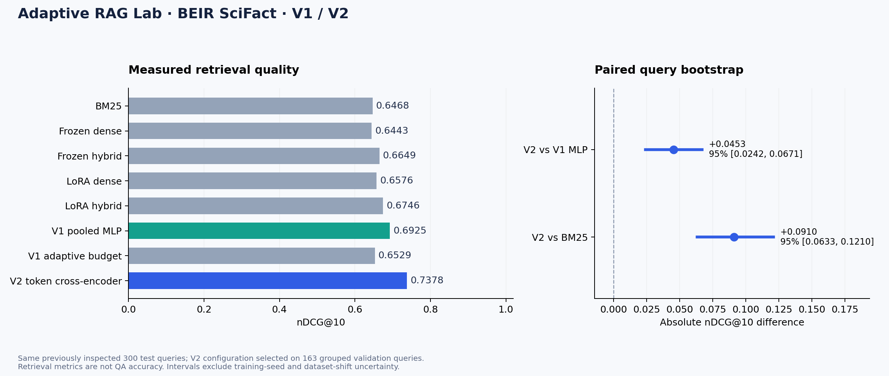
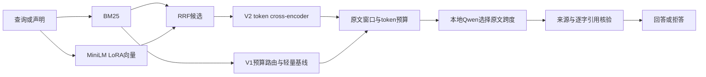

# Adaptive RAG Lab

**真实文献检索、模型微调、cross-encoder 重排和原文引用核验的本地 RAG 实验台。**

[](https://github.com/yyh20040202-ui/adaptive-rag-lab/actions/workflows/ci.yml)

在 BEIR SciFact 的 5,183 篇真实摘要上比较稀疏、向量、LoRA、轻量重排、预算路由与真正的 token cross-encoder；同一模型配置接入 FastAPI 问答。项目保存训练权重、逐查询结果、原始生成和失败原因，而不是只展示一次 API 调用。

这是使用 AI 辅助开发的个人学习与实验项目。未声称独立完成全部代码、企业投产、复现论文结果或 SOTA；面试前需要能独立解释、改动和重跑其中的模型与评估流程。

## 实测结果

验证冻结后的 V2 cross-encoder 在同一300条测试查询上取得 **nDCG@10 0.7378**、**Recall@10 85.36%**。

| 版本 / 方法 | nDCG@10 | MRR@10 | Recall@10 |
|---|---:|---:|---:|
| BM25 | 0.6468 | 0.6113 | 77.12% |
| Frozen dense | 0.6443 | 0.6025 | 78.50% |
| Frozen hybrid | 0.6649 | 0.6277 | 79.69% |
| LoRA dense | 0.6576 | 0.6169 | 79.93% |
| LoRA hybrid | 0.6746 | 0.6370 | 81.36% |
| V1 pooled MLP | 0.6925 | 0.6599 | 81.86% |
| V1 adaptive budget | 0.6529 | 0.6163 | 78.12% |
| V2 token cross-encoder | 0.7378 | 0.7065 | 85.36% |

相对 BM25：nDCG@10 绝对变化 +0.0910，相对变化 +14.07%，成对查询 bootstrap 95% 区间 [0.0633, 0.1210]。

相对 V1 pooled MLP：nDCG@10 绝对变化 +0.0453，相对变化 +6.54%，成对查询 bootstrap 95% 区间 [0.0242, 0.0671]。



646训练 / 163相关文档分组验证 / 300测试查询，seed42。**V1测试已被观察；V2是同一集合的迭代比较，不是全新盲测。** 置信区间只覆盖给定模型的查询重采样，不能代表训练种子或新领域。nDCG/Recall 是检索指标，不是问答准确率。

分组验证集选定 `gpustack/bge-reranker-v2-m3-GGUF`（revision `3093af03b1a635e67b084b1d8c03c5f5e020fd05`），重排深度 50，α=0.75，成对输入最多 384 tokens，实际推理 `GGUF-Q8_0-Vulkan`；验证 nDCG@10=0.7662。

完整记录：[V2分析](reports/quality_analysis.md)、[V2结果](reports/quality.json)、[验证网格](reports/quality_selection.json)、[逐查询结果](reports/quality_per_query.jsonl)。原始 [V1分析](reports/analysis.md) 和图表保留。

## 实现内容

- **真实检索器训练**：MiniLM query/value 层 LoRA，73,728个参数，BM25难负样本、温度0.05对比损失和已知假负例屏蔽。验证选第1轮；本项目没有微调Qwen。
- **两种重排**：V1使用池化交互特征MLP；V2比较MiniLM L6/L12 CPU动态INT8和BGE v2-m3 Q8_0 Vulkan的query/document联合token编码。只在验证集选择，实际量化运行参加测试；没有QAT或FP32质量等价声明。重排仅排序召回候选。
- **质量与预算分开呈现**：轻量路由在BM25路径实际跳过向量编码；V1减少95.67%向量调用，同时nDCG@10从0.6925降至0.6529。
- **可追溯引用**：原文跨度ID约束选择→恢复逐字quote→核对source_id和字符偏移；标题不是证据，失败则拒答。引用存在不证明语义结论正确。
- **普通笔记本资源控制**：CPU默认2线程，成对推理batch≤8；可用RAM低于2GiB或进程RSS超过3GiB时停止重计算。批前采样不是OS硬限额，多进程重任务需串行启动。
- **真实本地资料流程**：默认真实SciFact语料；用户知识库初始为空，支持当前会话文字/PDF导入、执行路径、来源展开与token预算，不把模拟制度载入主页面。

## 架构



训练、来源与限制见 [设计](docs/design.md)、[数据卡](DATA_CARD.md)、[模型卡](MODEL_CARD.md)、[面试准备](docs/interview.md)。

## Windows本地运行

Python3.10–3.12。CPU PyTorch已经足够，不需要安装CUDA训练包或购买云服务。首次下载公开数据、编码器与可选生成模型；基础模型不进Git仓库。下载脚本保存固定revision与文件SHA256，只加载本地safetensors/GGUF。

```powershell
git clone https://github.com/yyh20040202-ui/adaptive-rag-lab.git
cd adaptive-rag-lab
python -m venv .venv
.\.venv\Scripts\Activate.ps1
python -m pip install torch==2.5.1 --index-url https://download.pytorch.org/whl/cpu
python -m pip install -r requirements.txt
$env:ADAPTIVE_CPU_THREADS='2'
$env:ADAPTIVE_MIN_AVAILABLE_GIB='2.0'
python -m adaptive_rag.prepare --llama-win
python -m adaptive_rag.prepare_quality --l12
python -m adaptive_rag.prepare_quality --generator-4b
python -m adaptive_rag.prepare_quality --gpu-reranker
python -m adaptive_rag.index
```

生成模型可选0.6B、1.7B与4B Instruct；分别使用 `prepare --generator`、`prepare_quality --generator`、`prepare_quality --generator-4b` 下载。基础权重只在本机保存，大小/哈希核验后才启动。4B采用部分GPU offload以给独立BGE服务留出显存；先确认RAM和磁盘余量，其他硬件应重新测量。下面的启动型号来自本机下载记录，诊断结果以报告为准。

额外终端先启动选定的GPU重排服务，生成服务和重排服务可同时驻留，重任务按请求串行执行：

```powershell
python -m adaptive_rag.launch_generator --model-directory models/bge_reranker --reranker
```

另一个终端使用带资源看门狗的启动器开启本地生成模型（Vulkan、CPU2线程、context3072、batch256/ubatch128、单并发）：

```powershell
python -m adaptive_rag.launch_generator --model-directory models/qwen4 --gpu-layers 30 --context 3072 --no-mmap
```

启动器每2秒检查RAM，可用系统内存低于2GiB或自己启动的生成子进程RSS超过3GiB时停止该子进程；Ctrl+C也只停止自己启动的子进程。不会终止其他应用。模型选择和降级参数见`python -m adaptive_rag.launch_generator --help`；文件名来自下载记录，而不是假设固定量化文件名。本机当前记录为`models/qwen4/Qwen3-4B-Instruct-2507-Q4_K_M.gguf`。看门狗采样仍不是OS内存硬限额。

两个GGUF服务都显式使用 `--cache-ram 0 --ctx-checkpoints 0`，关闭跨提示RAM缓存与上下文检查点。本机早期重复诊断曾触发2GiB余量守卫；原始事件与处理保留在 [资源事件](reports/resource_incident.json)，不能把中断的三条输出写成完整六条结果。

4B启动器的 `--no-mmap` 对固定b11517运行时翻译为 `--load-mode none`。本机最初24层GPU/mmap加载同时驻留时触及RAM守卫；30层GPU加直接加载后重新运行。不是所有机器都受益，资源与GPU采样见 [运行核验](reports/runtime_verification.json)，需要按自身硬件复测。

第二个已激活环境的终端显式设置型号，再启动实验台：

```powershell
$env:LLAMA_MODEL_LABEL='Qwen3-4B-Instruct-2507 Q4_K_M'
$env:ADAPTIVE_CPU_THREADS='2'
python -m adaptive_rag.service
```

打开 [http://127.0.0.1:8088](http://127.0.0.1:8088)，接口文档`/docs`。只接受loopback生成地址；未启动模型时明确拒答。文字/PDF导入只存当前进程内存，重启清空。当前实现未提供公开部署所需的鉴权、多租户隔离和持久化。

## 重现实验

公开仓库提供小型LoRA/ranker/router权重。要重训和比较模型，在启动生成器前串行运行：

```powershell
python -m adaptive_rag.train --epochs 4 --seed 42
python -m adaptive_rag.benchmark --seed 42
python -m adaptive_rag.index
python -m adaptive_rag.prepare_quality --l12
python -m adaptive_rag.prepare_quality --gpu-reranker
# 在另一个终端启动BGE服务后，执行下面两步
python -m adaptive_rag.quality --stage select --variants l6 l12 bge
python -m adaptive_rag.quality --stage evaluate
python -m adaptive_rag.verify_reference
python -m pytest -q
```

`select`仅使用163条分组验证查询，在L6/L12/BGE、候选深度20/50/100、融合权重0/0.25/0.5/0.75/1中选择nDCG@10；同分优先浅候选、L6。没有Vulkan GPU时可先只用默认L6/L12重新选择。冻结配置写入`checkpoints/quality_config.json`，随后`evaluate`才比较同一300条测试查询。缓存指纹包含文档ID/正文、模型/tokenizer、adapter/config和池化设置，改变这些输入需要重建，旧版缺少元数据的缓存会被拒绝。

启动已选择的生成器后，另在设置过`LLAMA_MODEL_LABEL`的终端执行：

```powershell
python -m adaptive_rag.real_generation --mode cross_encoder --output reports/real_corpus_generation_v2.json
python -m adaptive_rag.quality_analysis
```

新图为`quality_benchmark.png/svg`，保留旧图不覆盖。`quality_analysis --text-only`可在V2待完成时生成明确标注缺失结果的文本，不生成假分数。

## 真实生成的范围

同一组固定真实文献声明：3 / 6 条输出通过机械来源/引用审计。

实际生成配置：Qwen3-4B-Instruct-2507 Q4_K_M; no thinking; temperature=0。

原始 V1 为 1 / 6 条；两版原始回答及拒答原因均保留。

2 / 6 条的打包上下文包含 qrels 标注相关来源；这仍不是答案正确标签。

拒答/审计记录：`missing_query_anchor`=2，`model_abstained`=1。

约束原文跨度选择会提高引用形式的可控性，但合法引用仍可能不支持结论；这些数量不能换算为 QA accuracy、语义支持率或幻觉率。

逐条回答、早期因果混淆和更换模型的诊断说明见 `docs/generation_review.md`；该复查使用同一已观察样例，并非独立标注评测。

两版使用相同六条SciFact测试声明，qrels只表示检索相关性。该集合已用于查看失败，不能称独立QA评测。12条历史手写制度样例只是调试回归，保存在原报告中，不进入主页面。

## 来源与许可

- [SciFact/AllenAI](https://github.com/allenai/scifact) 与 [BEIR](https://github.com/beir-cellar/beir)：声明/证据与摘要许可分别见数据卡；BEIR test不是原任务隐藏榜单。
- [MiniLM编码器](https://huggingface.co/sentence-transformers/all-MiniLM-L6-v2)、[cross-encoder L6](https://huggingface.co/cross-encoder/ms-marco-MiniLM-L6-v2)、[L12](https://huggingface.co/cross-encoder/ms-marco-MiniLM-L12-v2)：公开模型卡与本地固定版本/哈希。
- [BGE v2-m3](https://huggingface.co/BAAI/bge-reranker-v2-m3)、[GPUStack GGUF](https://huggingface.co/gpustack/bge-reranker-v2-m3-GGUF)：多语种预训练重排器的Q8_0本地推理，未在本项目微调。
- [Qwen3](https://huggingface.co/Qwen/Qwen3-1.7B)、[4B Instruct](https://huggingface.co/Qwen/Qwen3-4B-Instruct-2507)、[ggml-org GGUF](https://huggingface.co/ggml-org/Qwen3-1.7B-GGUF)、[LM Studio GGUF](https://huggingface.co/lmstudio-community/Qwen3-4B-Instruct-2507-GGUF)、[llama.cpp](https://github.com/ggml-org/llama.cpp)：本地推理，不进行Qwen微调。
- [LoRA](https://arxiv.org/abs/2106.09685) 与 [Adaptive Re-Ranking](https://arxiv.org/abs/2606.25249)：借鉴参数高效训练、按查询权衡质量与计算的思路；模型/数据/方法不同，不声称复现论文结果。
